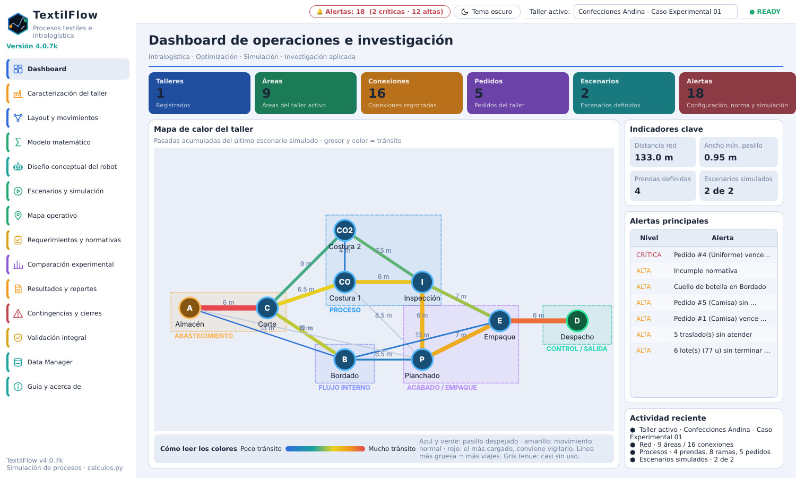
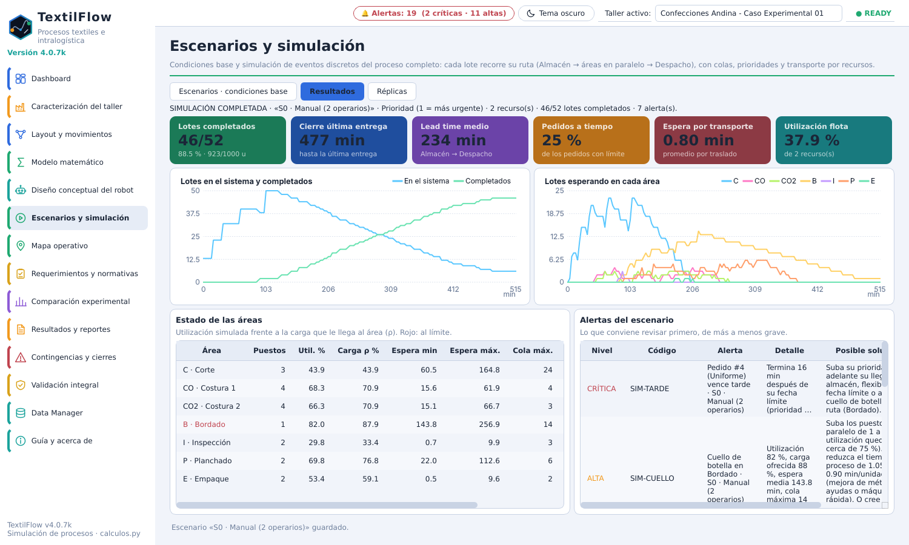
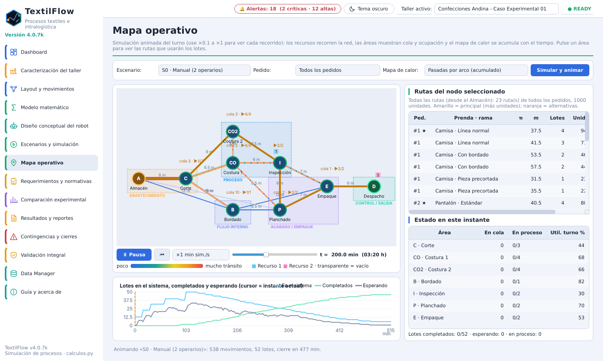
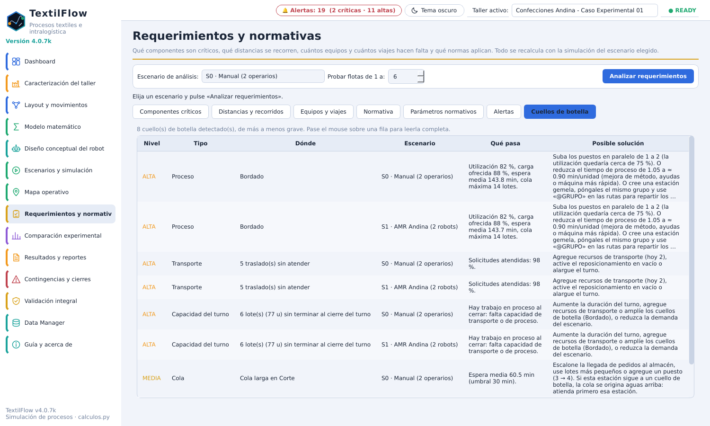
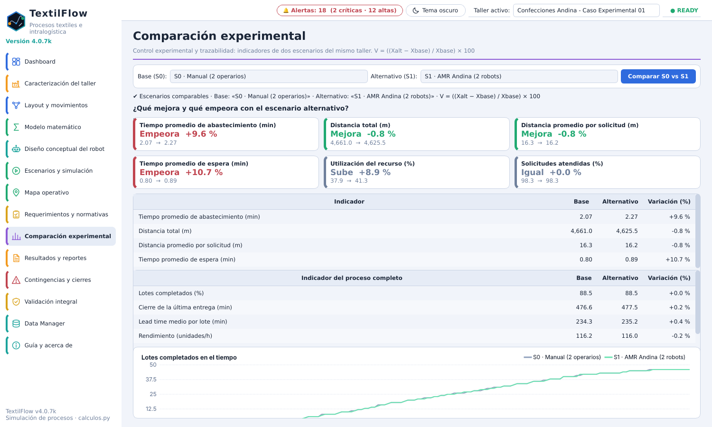
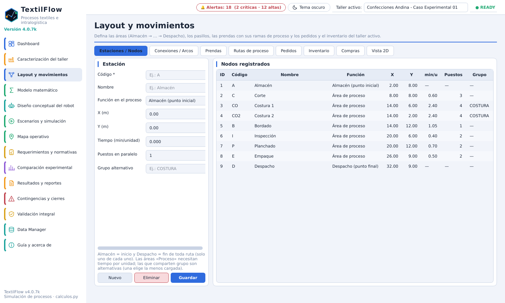
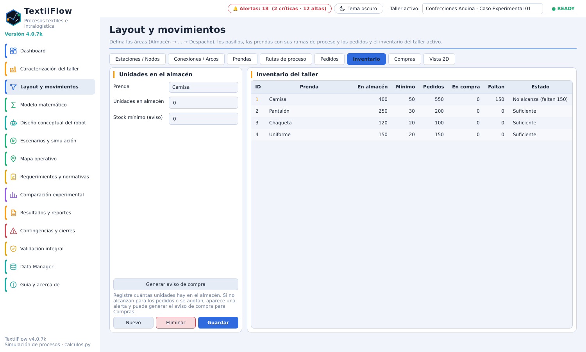
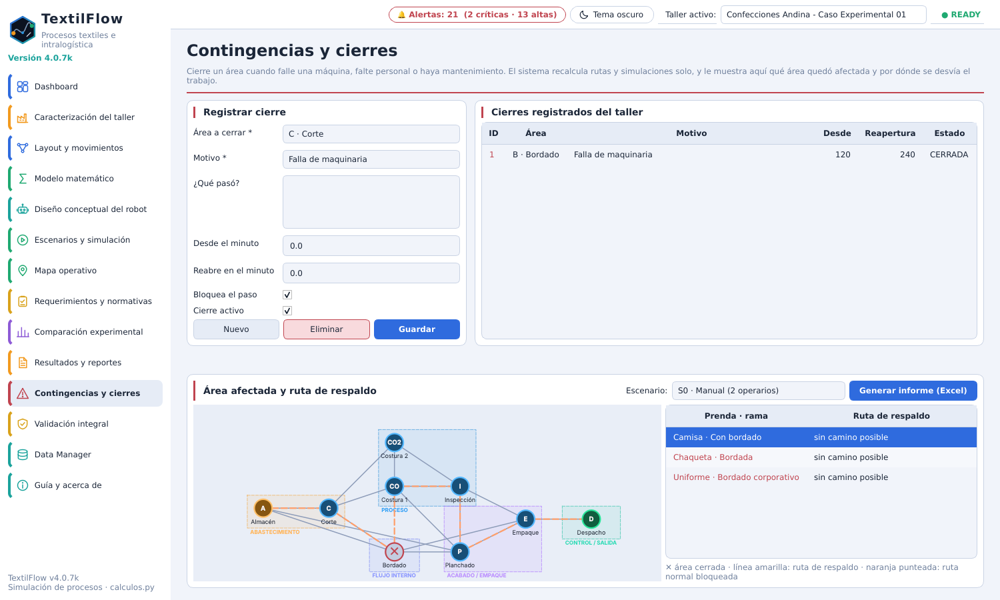
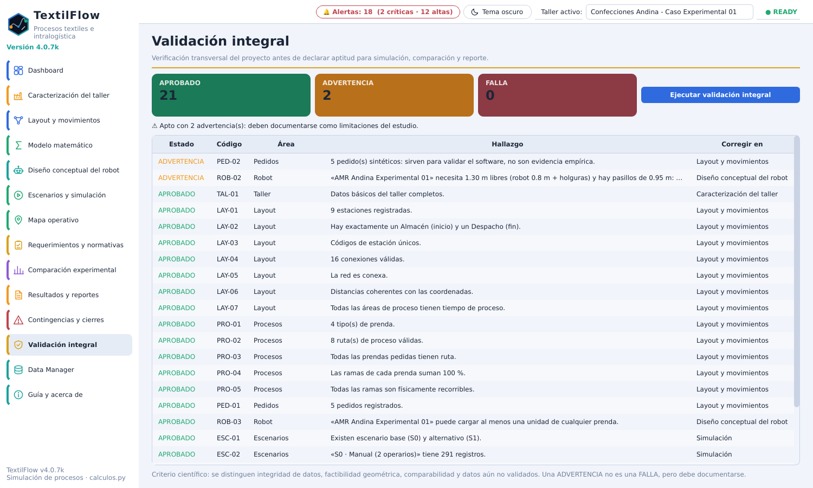

# TextilFlow 4.0.7k · optimización de procesos industriales e intralogística (PyQt6)



Aplicación de escritorio para talleres de confección: modela el **proceso completo Almacén → áreas en paralelo → Despacho**,
lo simula con eventos discretos y responde qué componentes son críticos, qué distancias se recorren, cuántos equipos y cuántos
viajes hacen falta, y si se respetan las prioridades. Mantiene el modelo matemático de `calculos.py` (sin modificar) y está
organizada en **MVC + arquitectura limpia**.

## Requisitos

* Python 3.11 o superior (probado con 3.13).
* Windows, Linux o macOS con entorno gráfico.
* Dependencias: `PyQt6`, `pandas`, `openpyxl`, `pytest` y `matplotlib` (esta última solo para `tools/ejercicio_practico.py`).

## Instalación y ejecución

Abra una terminal en la carpeta del proyecto (la que contiene `main.py`).

**Windows (PowerShell o CMD)**

```bat
python -m venv .venv
.venv\Scripts\activate
python -m pip install -r requirements.txt
python main.py
```

**Linux y macOS**

```bash
python3 -m venv .venv
source .venv/bin/activate
python -m pip install -r requirements.txt
python main.py
```

En la primera ejecución se crea la base de datos y se carga el taller de ejemplo «Confecciones Andina».
Las siguientes veces se abre el último estado guardado. Para salir del entorno virtual: `deactivate`.

### Opciones de arranque

| Comando | Qué hace |
|---|---|
| `python main.py` | Abre el programa con la base de datos por defecto. |
| `python main.py --db ruta/mi_taller.db` | Usa otro archivo de base de datos SQLite. |
| `python main.py --db :memory:` | Sesión temporal: no guarda nada en disco. |
| `python main.py --help` | Muestra la ayuda de los parámetros. |

Si se abre una segunda ventana con la misma base de datos, el programa avisa y no la abre.

### Dónde se guardan los datos

En la carpeta `.textilflow` del usuario (en Windows, `C:\Users\<usuario>\.textilflow`):

* `textilflow.db`: base de datos del proyecto.
* `respaldos/`: los 3 últimos respaldos automáticos.
* `textilflow.log`: registro de errores, útil para reportar un problema.

Para usar otra carpeta, defina la variable de entorno `TEXTILFLOW_HOME` antes de abrir el programa
(Windows: `set TEXTILFLOW_HOME=D:\datos`; Linux y macOS: `export TEXTILFLOW_HOME=/ruta`).
Si existe una base de datos de la versión 1, se conserva como `*.v1.bak` y se crea una nueva.

## Pruebas

```bash
python -m pytest              # las 102 pruebas
python -m pytest -q           # salida resumida
python -m pytest tests/test_casos_de_uso.py -k inventario    # solo las pruebas que contienen «inventario»
```

En un servidor sin pantalla: `QT_QPA_PLATFORM=offscreen python -m pytest` (Windows: `set QT_QPA_PLATFORM=offscreen`).

## Ejercicio práctico con réplicas

```bash
python tools/ejercicio_practico.py
```

Simula el taller de ejemplo con N réplicas y genera `docs/EJERCICIO_PRACTICO.md`, un CSV y un gráfico.

## Crear el ejecutable (.exe) en Windows

Con Python 3.11+ instalado, en la carpeta del proyecto:

```bat
construir_exe.bat
```

También puede hacer doble clic en el archivo. Genera `dist\TextilFlow.exe`, **un solo archivo** que se puede copiar a otro
computador sin instalar Python. El script usa `--onefile --noupx` y excluye los módulos de Qt que no se usan para que el
archivo pese menos y abra más rápido.

## Pantallas principales

| Pantalla | Para qué sirve |
|---|---|
| Dashboard | Resumen del taller, mapa de calor, indicadores y alertas principales. |
| Caracterización del taller | Área, operadores y jornada. |
| Layout y movimientos | Estaciones, conexiones, prendas, rutas de proceso, pedidos, **inventario** y **compras**, y vista 2D. |
| Modelo matemático | Variables y fórmulas de `calculos.py`. |
| Diseño conceptual del robot | Perfiles de robot y compatibilidad con los pasillos. |
| Escenarios y simulación | Escenarios manual y con robots, simulación y réplicas con IC 95 %. |
| Mapa operativo | Animación de lotes, colas, ocupación y rutas por área. |
| Requerimientos y normativas | Componentes críticos, distancias, equipos y viajes, normativa, **alertas** y **cuellos de botella**. |
| Comparación experimental | S0 frente a S1 con sus indicadores. |
| Resultados y reportes | Exportación a Excel. |
| Contingencias y cierres | Cierre de áreas, recálculo de rutas e informe de impacto. |
| Validación integral | Verificaciones de coherencia de los datos y del modelo. |
| Data Manager | Importar y exportar Excel, proyecto `.rlr`, respaldos y datos de ejemplo. |
| Guía y acerca de | Explicación del funcionamiento y versión. |

La barra superior muestra la insignia de alertas (se recalcula sola al guardar datos), el cambio de tema claro u oscuro,
el taller activo y el estado del programa. El programa abre con el **tema claro**; cada pestaña tiene su propio color en el menú lateral.

## Capturas de la interfaz

Capturas de la versión 4.0.7k con el tema claro y el taller de ejemplo «Confecciones Andina».

| | |
|---|---|
| <br>**Escenarios y simulación** | <br>**Mapa operativo** |
| <br>**Cuellos de botella** | <br>**Comparación experimental** |
| <br>**Layout y movimientos** | <br>**Inventario** |
| <br>**Contingencias y cierres** | <br>**Validación integral** |

Las 18 capturas están en `docs/img/`.

## Alertas, cuellos de botella e inventario

* Cada alerta trae su **posible solución**: configuración, normativa, cierres de área, simulación e inventario.
* Requerimientos y normativas → **Cuellos de botella** lista los cuellos de más a menos grave, con tipo, lugar y cómo resolverlos.
* Layout y movimientos → **Inventario**: unidades en almacén y stock mínimo por prenda. Si el taller se queda sin unidades o no
  alcanzan para los pedidos, se genera la alerta y el operador usa **Generar aviso de compra**.
* Layout y movimientos → **Compras**: la solicitud pasa de Pendiente a Pedida y Recibida (suma al inventario);
  **Copiar aviso para Compras** deja el mensaje listo para enviar.

## Cómo funciona (resumen)

1. **Layout**: áreas con `min/unidad`, `puestos` en paralelo y `grupo` (alternativas, p. ej. COSTURA = Costura 1 + 2); pasillos con distancia y ancho.
2. **Prendas y rutas**: cada prenda tiene peso, tamaño de lote y factor de dificultad; sus ramas reparten los pedidos
   (`A>C>@COSTURA>I>P>E>D` 55 %, `A>C>B>@COSTURA>…` 30 %…). `@GRUPO` = elegir el área menos cargada del grupo.
3. **Pedidos**: prenda, cantidad, prioridad (1 = urgente), llegada y fecha límite. Se parten en lotes.
4. **Simulación** (`domain/simulacion.py`): cola de eventos; cada área procesa hasta su número de puestos; al terminar, el lote pide
   transporte y el recurso libre más cercano lo lleva (por prioridad o FIFO). Viajes = ⌈unidades / ⌊capacidad / peso⌋⌉ por traslado.
5. **Modelo matemático** (`calculos.py`): con los traslados simulados calcula tiempo de abastecimiento, distancia, espera, utilización,
   % atendidas y la variación S0 → S1; se complementa con la **carga ofrecida ρ** analítica de cada área.

## Normativa: qué está verificado y qué no

Los parámetros están en *Requerimientos → Parámetros normativos* con su fuente y la columna **Verificado**:

| Verificado contra el texto de la norma | Res. 2400/1979: pasillo ≥ 1,20 m (Art. 12), distancia entre máquinas ≥ 0,80 m, 2 m² por trabajador |
|---|---|
| **No verificado** (cita secundaria) | límites de carga manual (25 / 12,5 kg), velocidad 0,3 m/s sin detección (ISO 3691-4) |
| **Criterio de diseño** (no es norma) | holgura lateral del robot, umbrales de cuello de botella, de espera, de saturación y de flota ociosa, utilización objetivo |

Confirme los no verificados antes de citarlos. La factibilidad del robot por ancho es geométrica, no una evaluación de riesgos.

## Arquitectura

```
presentacion (MVC)   views/ (PyQt6, pasivas) ←→ controllers/ → casos de uso      widgets/ (mapa, gráficos, logo SVG)
aplicación           use_cases/, ports.py (interfaces), dto.py
dominio              entities, calculos, routing, simulacion, analisis, normativa, alertas, estadistica, validacion, datos_demo
infraestructura      persistence/ (SQLite), excel/ (openpyxl), archive/ (proyecto .rlr)
contenedor           container.py (raíz de composición)
```

`domain` no importa Qt, SQLite ni openpyxl; `application` solo conoce los puertos. Las vistas reciben tuplas y modelos de vista,
no entidades. Los nombres de carpetas del código (`presentation`, `application`, `domain`, `infrastructure`) siguen el
patrón de arquitectura limpia.

## Límites del modelo

* Datos del ejemplo **sintéticos**: validan el software, no son mediciones.
* No modela averías, baterías ni cruces entre recursos en un mismo pasillo.
* El stock no se descuenta durante la simulación: las alertas de inventario comparan las unidades con los pedidos registrados.
* La importación y exportación a Excel todavía no incluye el inventario (sí viaja en el proyecto `.rlr` y en los respaldos).
* El transporte manual y el AMR solo se diferencian por velocidad, capacidad y ancho requerido; si el transporte no es la restricción
  (como en el ejemplo, donde lo es Bordado), cambiar de S0 a S1 apenas mueve el resultado. El programa lo señala en vez de ocultarlo.

## Historial de cambios

El detalle de cada versión y cómo funciona cada cambio está en **CAMBIOS_4.0.7k.md** (copia en `docs/`).
