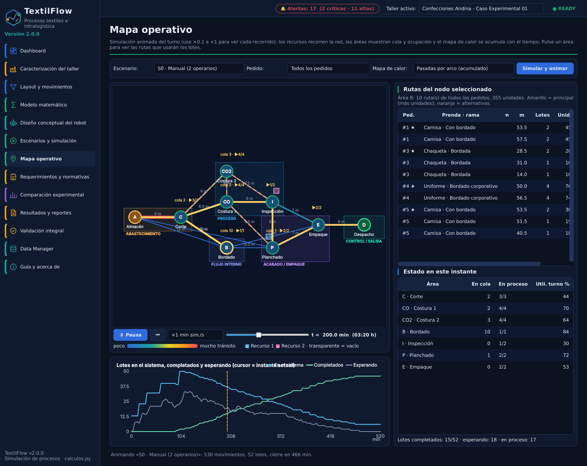
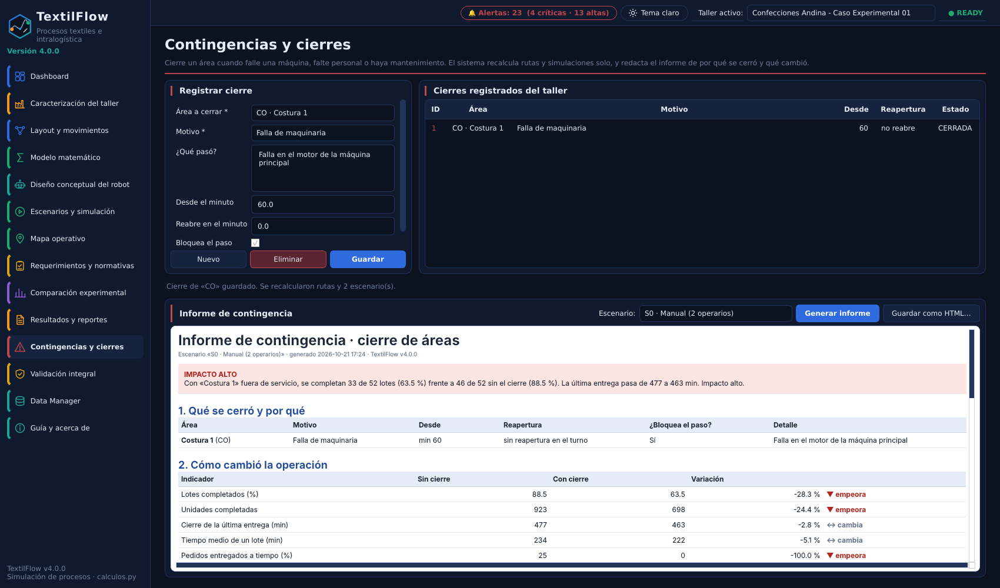

# TextilFlow 4.0.6 · optimización de procesos industriales e intralogística (PyQt6)



Aplicación de escritorio para talleres de confección: modela el **proceso completo Almacén → áreas en paralelo → Despacho**,
lo simula con eventos discretos y responde qué componentes son críticos, qué distancias se recorren, cuántos equipos y cuántos
viajes hacen falta, y si se respetan las prioridades. Mantiene el modelo matemático de `calculos.py` (sin modificar) y está
organizada en **MVC + arquitectura limpia**.

## Ejecutar

```bash
pip install -r requirements.txt
python main.py                      # datos en ~/.textilflow/textilflow.db (1.ª vez carga el caso de ejemplo)
python main.py --db :memory:        # sesión sin guardar
python -m pytest                    # 76 pruebas
python tools/ejercicio_practico.py  # ejercicio práctico con N réplicas → docs/EJERCICIO_PRACTICO.md
```

Si existe una base de datos de la versión 1, se **conserva** como `*.v1.bak` y se crea una nueva (el modelo cambió).

## Crear el .exe (Windows)

Doble clic en `construir_exe.bat` (necesita Python 3.11+ instalado). Genera `dist\TextilFlow.exe`, un solo archivo que se puede copiar a otro computador.

## Qué hay de nuevo en 4.0

| Necesidad | Dónde |
|---|---|
| **Cerrar un área** (falla de maquinaria, mantenimiento, falta de personal…) con motivo, hora de inicio y de reapertura | **Contingencias y cierres** |
| Recalcular rutas y volver a simular todos los escenarios al instante | automático al guardar el cierre |
| **Informe** de por qué se cerró y qué cambió (impacto, rutas nuevas, trabajo sin terminar, recomendaciones), se genera en Excel con fecha y hora de cada cierre | **Contingencias y cierres** |
| Áreas cerradas con ✕ roja | Mapa operativo, Dashboard, Layout |
| **Tema claro / oscuro** | botón en la barra superior |



## Qué había de nuevo en 2.0

| Necesidad | Dónde |
|---|---|
| Componentes críticos, distancias, equipos y viajes, normativa | **Requerimientos y normativas** |
| Escenarios / condiciones base, simulación, **N réplicas** con IC 95 % | **Escenarios y simulación** |
| Almacén = inicio, Despacho = fin; más áreas; cada prenda con varias **ramas** (corte / bordado / planchado…) | **Layout y movimientos → Áreas, Prendas, Rutas, Pedidos** |
| Pulsar un área y ver las rutas que usarán los lotes, por pedido | **Mapa operativo** |
| **Mapa de calor dinámico** (se acumula con el tiempo), colas y ocupación animadas | **Mapa operativo**, Dashboard |
| Alertas (cuello de botella, pedido tarde, flota saturada, norma…) | insignia 🔔 superior, Escenarios, Requerimientos |
| Versión y logo | barra lateral, título de la ventana, **Guía y acerca de** |
| Explicación del funcionamiento | pestaña **Guía** y [docs/FUNCIONAMIENTO.md](docs/FUNCIONAMIENTO.md) |

## Cómo funciona (resumen)

1. **Layout**: áreas con `min/unidad`, `puestos` en paralelo y `grupo` (alternativas, p. ej. COSTURA = Costura 1 + 2); pasillos con distancia y ancho.
2. **Prendas y rutas**: cada prenda tiene peso, tamaño de lote y factor de dificultad; sus ramas reparten los pedidos
   (`A>C>@COSTURA>I>P>E>D` 55 %, `A>C>B>@COSTURA>…` 30 %…). `@GRUPO` = elegir el área menos cargada del grupo.
3. **Pedidos**: prenda, cantidad, prioridad (1 = urgente), llegada y fecha límite. Se parten en lotes.
4. **Simulación** (`domain/simulacion.py`): cola de eventos; cada área procesa hasta su número de puestos; al terminar, el lote pide
   transporte y el recurso libre más cercano lo lleva (por prioridad o FIFO). Viajes = ⌈unidades / ⌊capacidad / peso⌋⌉ por traslado.
5. **Modelo matemático** (`calculos.py`): con los traslados simulados calcula tiempo de abastecimiento, distancia, espera, utilización,
   % atendidas y la variación S0 → S1; se complementa con la **carga ofrecida ρ** analítica de cada área.

## Normativa: qué está verificado y qué no

Los parámetros están en *Requerimientos → Parámetros normativos* con su fuente y la columna **Verificado**:

| Verificado contra el texto de la norma | Res. 2400/1979: pasillo ≥ 1,20 m (Art. 12), distancia entre máquinas ≥ 0,80 m, 2 m² por trabajador |
|---|---|
| **No verificado** (cita secundaria) | límites de carga manual (25 / 12,5 kg), velocidad 0,3 m/s sin detección (ISO 3691-4) |
| **Criterio de diseño** (no es norma) | holgura lateral del robot, umbrales de cuello de botella, de espera, de saturación y de flota ociosa, utilización objetivo |

Confirme los no verificados antes de citarlos. La factibilidad del robot por ancho es geométrica, no una evaluación de riesgos.

## Arquitectura

```
presentation (MVC)   views/ (PyQt6, pasivas) ←→ controllers/ → casos de uso      widgets/ (mapa, gráficos, logo SVG)
application          use_cases/, ports.py (interfaces), dto.py
domain               entities, calculos, routing, simulacion, analisis, normativa, alertas, estadistica, validacion, datos_demo
infrastructure       persistence/ (SQLite, esquema v2), excel/ (openpyxl), archive/ (.rlr v2)
container.py         raíz de composición
```

`domain` no importa Qt, SQLite ni openpyxl; `application` solo conoce los puertos. Las vistas reciben tuplas y view-models, no entidades.

## Límites del modelo

* Datos del ejemplo **sintéticos**: validan el software, no son mediciones.
* No modela averías, baterías ni cruces entre recursos en un mismo pasillo.
* El transporte manual y el AMR solo se diferencian por velocidad, capacidad y ancho requerido; si el transporte no es la restricción
  (como en el ejemplo, donde lo es Bordado), cambiar de S0 a S1 apenas mueve el resultado. El programa lo señala en vez de ocultarlo.
